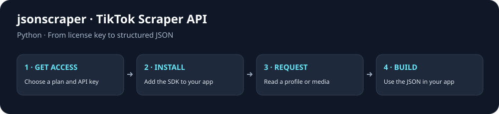

# TikTok Scraper API for Python

[](https://github.com/jsonscraper/tiktok-api-python/tags)
[](#quick-start)
[](https://github.com/jsonscraper/tiktok-api-python/commits)
[](LICENSE)
[](https://www.postman.com/evelode/workspace/evelode/collection/24862082-d886cc87-4267-4e0c-b57a-2d083add50ad)

A small, configurable client with named methods and ready-to-run examples. Supports **54 TikTok Scraper API methods**.

**Package:** `jsonscraper-tiktok` · **[Methods](#main-methods)** · **[Examples](#ready-to-run-examples)** · **[Documentation](docs/guide.md)**



## Quick start

**1. Get your key** from the [TikTok API product page](https://jsonscraper.com/services/tiktok-scraper-api?utm_source=github&utm_medium=sdk&utm_campaign=tiktok-api-python&utm_content=readme) and set it on your server:

```sh
export JSONSCRAPER_TIKTOK_LICENSE_KEY='your-license-key'
```

**2. Install the package:**

```sh
python -m pip install "git+https://github.com/jsonscraper/tiktok-api-python.git@0.1.1"
```

**3. Make a request:**

```python
import os
from jsonscraper_tiktok import TikTok, APIError

client = TikTok(os.environ["JSONSCRAPER_TIKTOK_LICENSE_KEY"], timeout=30, retries=1)
try:
    response = client.get_user_info(query="therock", cache_timeout=60)
    if response.get("status") != "ok":
        raise RuntimeError("The API returned an application error")
    print(response["tiktok"])
except APIError as error:
    print(f"HTTP {error.status}; check your key, quota, or parameters")
```

The API payload is in `tiktok`. Live calls require a valid API license and may consume quota. [Response examples and status handling](docs/responses.md).

## Main methods

54 methods are available. Common starting points:

| What you need | Method |
| --- | --- |
| Read a profile | `get_user_info()` |
| Read a video | `get_video_by_id()` |
| Get a video download URL | `get_no_watermark_url()` |
| Read comments | `get_comments_by_id()` |
| Search videos | `search_video()` |
| List profile videos | `get_user_feed()` |

[All methods and parameters →](docs/endpoints.md)

## Ready-to-run examples

- [Read a profile](examples/endpoints/get_user_info.py).
- [Read a video](examples/endpoints/get_video_by_id.py).
- [Read comments](examples/endpoints/get_comments_by_id.py).
- [Search videos](examples/endpoints/search_video.py).
- [List profile videos](examples/endpoints/get_user_feed.py).

Each example includes command-line parameters, key setup, timeouts, error handling and response output. Run it with `--help` first; this makes no API request.

**[Browse all 54 complete examples](examples/README.md)** · **[Full method and parameter reference](docs/endpoints.md)**

## Configuration

Requests use a 30-second timeout by default. Configure caching and retries to fit your application's request budget. Keys are read from your server environment; redirects are disabled.

[Configuration options, HTTP errors, caching and pagination](docs/configuration.md) · [Full integration guide](docs/guide.md)

## Use with ChatGPT and Codex

Prefer an assistant connection? Use the separate [TikTok MCP server](https://jsonscraper.com/mcp/tiktok?utm_source=github&utm_medium=sdk&utm_campaign=tiktok-api-python&utm_content=mcp). It accepts the same product API license and uses the normal API quota. [MCP source and setup](https://github.com/jsonscraper/tiktok-mcp-server).

## Access, pricing and support

The SDK source is **MIT-licensed**. Hosted API access requires a separate TikTok license. Check [current plans and get access](https://jsonscraper.com/services/tiktok-scraper-api?utm_source=github&utm_medium=sdk&utm_campaign=tiktok-api-python&utm_content=readme).

[Service support](https://jsonscraper.com/contacts?utm_source=github&utm_medium=sdk&utm_campaign=tiktok-api-python&utm_content=support) · [SDK issues](https://github.com/jsonscraper/tiktok-api-python/issues) · [Changelog](CHANGELOG.md) · [MIT license](LICENSE)

## Development

```sh
python3 tests/contract.py
```

Tests use a local/mock server and require no API key. A [GitHub Actions template](docs/github-actions.yml) is available for optional automation.

The SDK has no installation or usage telemetry. README links use campaign parameters for website referral analytics. jsonscraper is independent and is not affiliated with TikTok.
